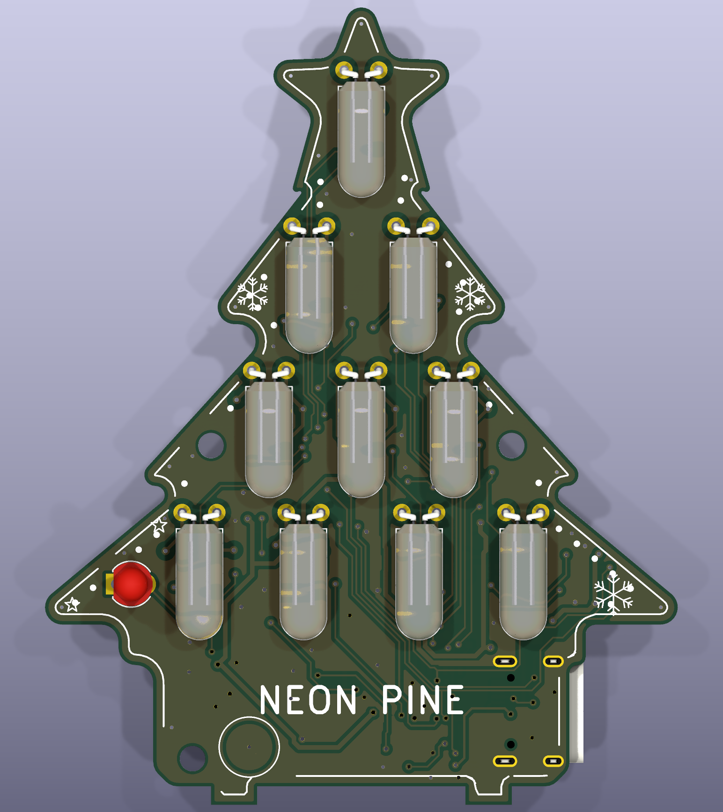
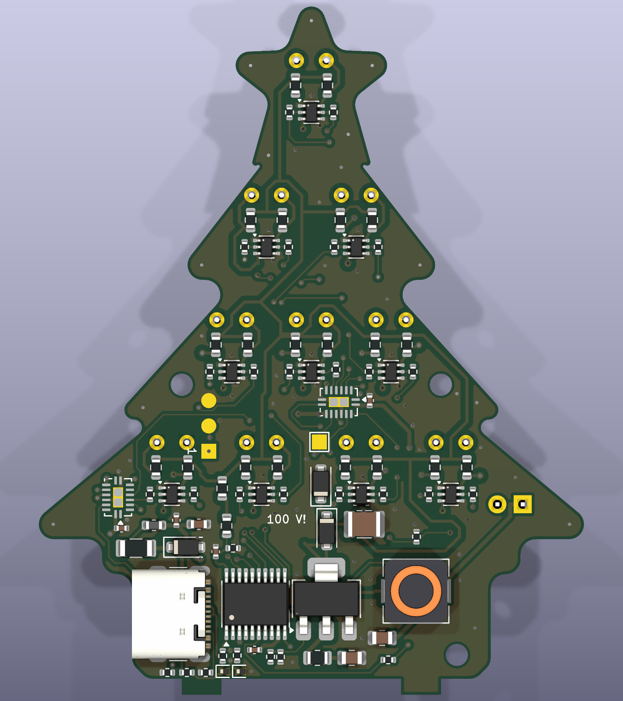
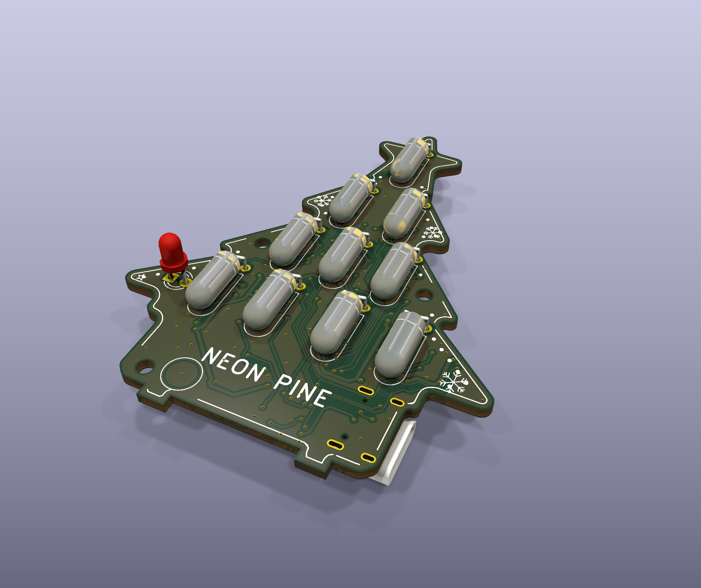
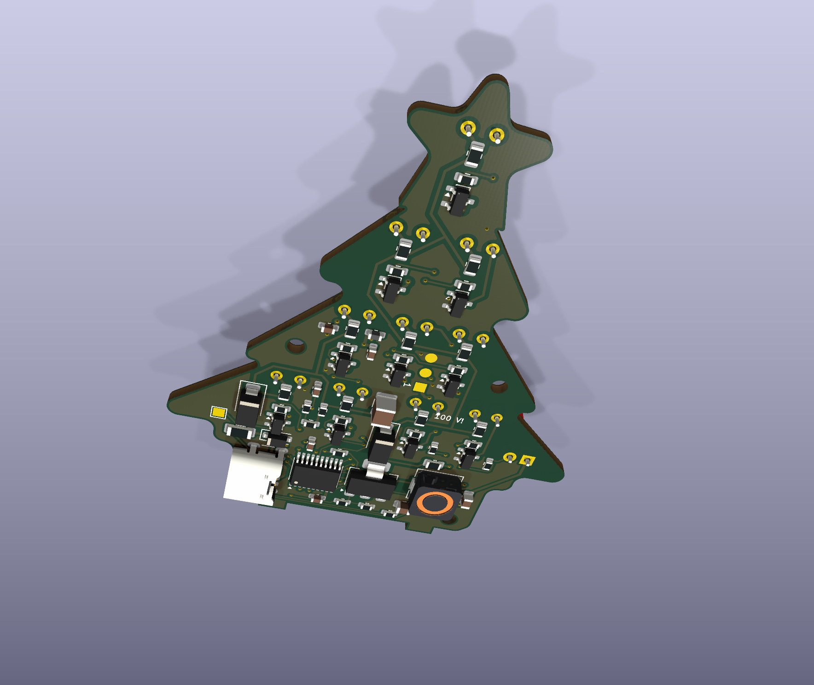
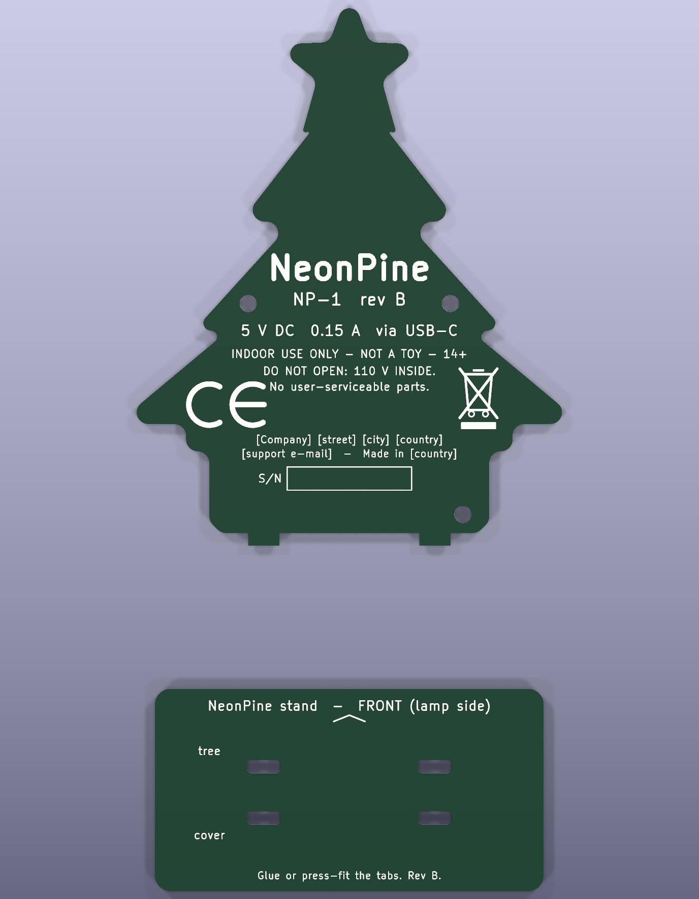

# NeonPine – neon‑lamp Christmas tree night light

54.8 × 69.1 mm tree‑shaped PCB with 10 Brightmaster NEON‑3 neon lamps, powered from USB‑C 5 V.

> **Branch `AC` – bipolar lamp drive (work in progress).** Each lamp now sits in an H‑bridge (§2.3), so either electrode can glow,
> both can (alternating), or neither. The board keeps the rev B size; to make room, each lamp's switches are one
> **MMDT5551 dual 160 V NPN (SOT‑363)** with 0603 HV pull‑ups and 0402 base resistors (one 5.4 × 6.3 mm stack per lamp),
> the low‑voltage passives are 0402, the shift registers are DHVQFN‑16, D1/D2 moved to SOD‑123F, and the
> lamps moved slightly (tier 1 ±4.5 mm at y 21.5, tier 2 ±8 mm at y 34, tier 3 ±5/±14 mm at y 46.3), and the board is 2 layers.
> U2 sits in the centre of tier 3, U3 in the right wing next to lamps 9/10.
> **2026‑10‑08:** SR_DATA/SR_CLK moved to the SPI1 pins PC6/PC5; LAMP6/LAMP9 moved to PD6/PA1, and the board is re‑routed
> (0 unconnected). R13 (33 Ω 0402, SPI clock series resistor, PC5 → SR_CLK) is in the schematic but **not yet placed on the PCB**.
> **Routing status (2 layers, 2026‑10‑08): fully routed** (Freerouting + scripted SOT‑363 fan‑outs + hand routing, U2 QE–QG
> swapped by hand). 0 unconnected, 0 errors with the HVBUS/PWR pattern fixes; the hand edits (J2, U3, Q15/R55 around lamp 5)
> live only in the board file – `tools/pcb.py` would not reproduce them.
> The renders under `docs/img`, the `fab/` outputs, the BOM CSV and the compliance documents still describe rev B.
A CH32V003 MCU runs a 75–105 V boost converter and drives each lamp separately.
Rev B adds a screwed‑on rear cover (with the product markings) and a slot‑in stand base. Unit manufacturing cost ≈ €19 / €9 / €6 at 10 / 100 / 500 pcs
([manufacturing §7](docs/manufacturing.md)).

| Front | Back (cover removed) |
|---|---|
|  |  |
|  |  |

| Rear cover (outer face) and stand base – `NeonPine-cover.kicad_pcb` |
|---|
|  |

**Status (2026‑10‑06): rev B layout is complete.** It is fully routed: 0 DRC violations, 0 unconnected items, and schematic
parity shows only cosmetic field differences. All rev A design actions that blocked market release are done in hardware (§7).
**Still open before market release:** firmware, bench and safety verification, the EMC test campaign, supplier declarations,
and the company details in the markings ([regulatory roadmap](docs/compliance/00-regulatory-roadmap.md)).

| Document | Contents |
|---|---|
| [docs/NeonPine-schematic.pdf](docs/NeonPine-schematic.pdf) | Schematic (generated) |
| [docs/README.md](docs/README.md) | Index of all product documentation |
| [docs/compliance/](docs/compliance/) | Regulatory roadmap, risk assessment, EMC test plan, materials, draft DoC / SDoC, labelling, technical file |
| [docs/user-manual.md](docs/user-manual.md) | User instructions and safety information (draft) |
| [docs/manufacturing.md](docs/manufacturing.md) | PCB spec, assembly incl. cover & stand, programming, end‑of‑line test, traceability |
| [fab/](fab/) | Main board: Gerbers + drill, pick & place, BOM, STEP. Cover + stand: Gerbers + drill |

## 1. Concept

```
                 ★   L1 hangs from the centre of the star
            L2   L3            tier 1
         L4   L5   L6          tier 2          ○ cover screw holes in the tier‑2 wings
       L7   L8   L9   L10      tier 3          light sensor = "ornament" in the left wing
       ○   ┃   pot   ┃         "NEON PINE", trunk touch pad TP2, USB‑C on the right edge
           ┗━┛     ┗━┛         two stand tabs → slot into the base plate
```

* **Lamps:** Brightmaster **NEON‑3** (TME). Ø4 × 10 mm, orange, both wire leads out of one end, rated 65 V AC / **90 V DC**
  maximum striking voltage, 0.5 mA, 20 000 h. Brightmaster does not publish the maintaining voltage, so we assume ≈ 60 V as for an NE‑2.
  * Footprint `NeonPine:Lamp_Neon_Brightmaster_NEON-3_D4x10_P3.0`: 3.0 mm lead pitch, and the body lies flat on the front,
    hanging down like an ornament.
  * Rev B: the star lamp LA1 hangs from the centre of the star like the others, so its glass stays on the board.
  * 3D model from `tools/lamp3d.py`.
* **Sides:** only the lamps, light sensor and trunk touch pad are on the front. Everything else is SMD on the back, under the rear cover.
* **Front art (silkscreen):** a rim line, bead "fairy lights" along the branches, snowflakes, stars and the NEON PINE logotype.
  It is clipped automatically around pads, holes and parts (`art()` in `tools/pcb.py`).
* **Rear cover:** a plain FR‑4 plate in the tree shape, on 3 × M2 × 5 mm standoffs. It covers every HV part and carries the
  product markings in silkscreen: model, rating, CE, WEEE bin, warnings, manufacturer, S/N field.
* **Stand:** two 4 mm tabs on the bottom edge of the tree and of the cover plug into a 50 × 26 mm base plate.
  The base comes from the same cover/stand Gerber set.

## 2. Schematic ([PDF](docs/NeonPine-schematic.pdf))

### 2.1 Power in
```
USB‑C J1 (GCT USB4125-GF-A) VBUS ─┬─ F1 PTC 0.5 A (MF-NSMF050-2) ── VBUS_F ── FB1 600 Ω@100 MHz ──┬── +5V
CC1 ─R3 5k1─ GND, CC2 ─R4 5k1─ GND D3 SMF5.0A TVS (at the connector)              C1 10µ, C2 100n ┘
```
* +5V feeds U1 (C6 100n at VDD) and the boost (C3 22µ/10V). The ferrite and the caps form a π filter that keeps boost noise off the USB cable.
* The MCU runs straight from 5 V (the CH32V003 is rated 2.7–5.5 V), so the gate drive is a full 5 V.
* The expected maximum input is about 0.1 A.

### 2.2 HV boost (the MCU is the controller)
```
+5V ── L11 330µH ──SW──┬── D1 200 V fast ────┬──────────┬──────────┬── HV+ (75–105 V)
                       │   (R12 100Ω + C8    C4 1µ/250V D2 SMF100A  R5 1M ─ R6 1M ─┬─ VFB → PD3 (ADC A4)
                  Q1 DMN15H310SE  100p snubber, (1210)   (clamp)                 R7 39k ║ C5 10n
PD2 ─R1 47Ω─ G    (150 V, 330 mΩ @ 5 V)  DNP)  │          │                       │
          R2 100k to GND                     GND        GND                     GND
```
* **Q1 DMN15H310SE:** 150 V, R_DS(on) 330 mΩ at V_GS = 5 V. **R2 is required**: it keeps the boost off during reset and programming.
  D2 (SMF100A, SOD‑123F, 200 W) clamps HV+ at V_BR 111–123 V, below Q1’s 150 V.
* **R12/C8:** an RC snubber across Q1, not fitted by default (DNP). Fit it if pre‑compliance shows SW‑node ringing at 30–100 MHz.
* **L11:** 330 µH shielded 6 × 6 × 2.8 mm (SWPA6028S331MT, **verify I_sat ≥ 0.4 A** on the datasheet).
  Footprint `NeonPine:L_6.3x6.3_H3`, 3D model from `tools/inductor3d.py`.
* **Design point:** 30 kHz in discontinuous conduction mode, P_out max ≈ 0.35 W, I_pk ≈ 0.27 A, t_on ≈ 18 µs at 105 V.
* **Feedback:** 2 M / 39 k gives 105 V → 2.0 V at the ADC. Calibrate against Vrefint.
  The divider also bleeds C4 after unplugging (τ ≈ 2 s, below 60 V in about 1.1 s).
* **Protection:**
  * Firmware: 60 % duty clamp, an overvoltage trip at 110 V, and the IWDG watchdog.
  * Hardware: R2 (gate pull‑down), D2 (clamp), F1 (PTC), D3 (TVS).
  * Firmware limits are **not** counted as safety measures.
* **Stored energy:** at most ½ · 1 µF · 105 V² ≈ 5.5 mJ in C4.

### 2.3 Lamp channel (× 10) – H‑bridge per lamp
```
          HV+                               HV+
           │                                 │
   R2n 150k (0603, 200 V)            R3n 150k (0603, 200 V)
           │                                 │
      A ───┴──── pad 2 ┤NEON LAn├ pad 1 ─────┴─── K
           │                                 │
  Q1n unit B collector C2            Q1n unit A collector C1     (Q1n = MMDT5551, 160 V dual NPN)
  base ─ R5n 22k ─ LAMPAn (74HC595)   base ─ R4n 22k ─ LAMPn (MCU pin, one lamp on the 74HC595)
  emitter ─ GND                       emitter ─ GND
```
| Q1n B (A side) | Q1n A (K side) | Result |
|---|---|---|
| off | off | dark, no current |
| off | **on** | K is the cathode: the **pad‑1 electrode** glows |
| **on** | off | A is the cathode: the **pad‑2 electrode** glows |
| alternate ≥ 100 Hz | | both electrodes glow (AC look); also evens out cathode wear |
| on | on | dark, but both pull‑ups draw current – firmware never does this |

* **Parts:** Q1n = MMDT5551 (Diodes Inc., V_CEO 160 V, SOT‑363, pin‑out E1 B1 C2 E2 B2 C1); 160 V covers the 123 V D2 clamp.
  The pull‑ups dissipate up to 105² / 150 k = 74 mW (the lead that is pulled low), so they must be **0603 high‑voltage
  thick film rated ≥ 200 V / 0.1 W** (e.g. RCV0603); a standard 0603 is only rated 75 V. 0402 is not possible here (≤ 100 V even in HV series).
  No 160 V+ dual NPN exists in a DFN package (Nexperia's DFN2020 doubles stop at 120 V, PBSS4112PAN), and there is no quad.
* Lamp current is I = (V_HV − 60 V) / 150 k through the pull‑up of the lead that is *not* pulled low: 0.31 mA at 105 V, 0.11 mA at 75 V.
  **The HV rail works as a smooth global dimmer (about 3:1)**, and per‑lamp BAM adds detail on top of it.
* **Power budget – the cost of this topology.** The pull‑up on the lead that *is* pulled low also conducts, V_HV / 150 k = 0.5–0.7 mA,
  more than the lamp itself. One lit lamp therefore takes 1.0 mA × 105 V ≈ 105 mW from the rail (45 mW at 75 V); ten lit lamps take
  ≈ 1.05 W at 105 V. The rev B boost (§2.2) delivers ≈ 0.35 W (≈ 0.45 W in theory at the 60 % duty clamp), so **the firmware must
  hold Σ duty × P_lamp(V_HV) under about 0.35 W**, e.g. by lowering V_HV when many lamps are lit. For full brightness on all lamps
  the boost needs about 3× the power: a lower inductance with I_sat ≥ 1 A (e.g. 100 µH) plus a firmware frequency/duty retune –
  open item, not done in this branch.
* **Striking:**
  * Firmware starts the rail at ≥ 95 V (a kick to 105 V), and only ramps down once the lamps have struck.
  * A lamp that drops out below about 65 V is re‑struck with the same kick.
* **Touch current at the lamp leads** is at most 105 V / 150 k = **0.7 mA DC**, because both leads are fed only through their 150 k pull‑ups.
* With DC drive only the cathode glows; here the firmware chooses which lead is the cathode, per lamp and per BAM slot.
* **Dark effect:**
  * Firmware keeps BAM at 1 kHz or faster with a minimum on‑time, plus a 50 ms kick at first ignition.
  * Lamps with a radioactive additive (Kr‑85) must **not** be used.

### 2.4 Inputs
| Input | HW | Use |
|---|---|---|
| **TP2 trunk touch pad** (front, Ø4 mm, **covered by solder mask**) | R11 1 k to PA2 (TKEY) | tap: next animation · hold: brightness ramp · double‑tap: sleep timer · hold 3 s: off/on |
| **Light sensor** Q2 TEPT4400 (Vishay, Cd‑free NPN phototransistor, front left wing) | +5V → C, E → PD5, R9 22k to GND | auto on at dusk / off in daylight, room‑adaptive brightness, wave‑to‑switch. 20 lx → 0.3–1.5 V, 100 lx → about 4.4 V |
| **TP3** (back pad) | PA1 | spare / test point |

Rev B removed the star touch pad TP1 and its resistor R10, and replaced the CdS LDR (GL5528, contains cadmium) with the TEPT4400.
**Wave‑to‑switch:** the light sensor is read in the BAM slot where all lamps are dark and again in a lit slot; the difference is the tree's own
light reflected off a hand.

### 2.5 MCU pin map – CH32V003F4P6 (TSSOP‑20)
| Pin (port) | Function |
|---|---|
| 10–14, 17 (PC0–PC4, PC7) | Cathode‑side switches of lamps **L7, L4, L2, L5, L3, L10** |
| 8 (PD0) / 3 (PD6) / 5 (PA1) | Cathode‑side switches of **L8 / L6 / L9**. The cathode side is now spread over ports C, D and A: three port writes per BAM slot |
| 16 (PC6) / 15 (PC5) / 1 (PD4) | **SR_DATA (SPI1 MOSI) / SR_CLK (SPI1 SCK, via R13 33 Ω: net SR_SCK → SR_CLK) / SR_LATCH** to the 74HC595 chain U2 → U3 (TP3 sits on SR_CLK). Hardware SPI (+ DMA) shifts the 16 bits in the background; the firmware only pulses the latch at the slot edge |
| 19 (PD2) | TIM1_CH1 → boost gate (via R1) |
| 20 (PD3) | A4 – HV feedback |
| 2 (PD5) | A5 – light sensor |
| 6 (PA2) | A0 – TP2 trunk touch |
| 18 (PD1) | SWIO, on pogo pads J2 (5V / SWIO / GND), back side |
| 4 (PD7) | NRST (C7 100n to GND) |

**Shift registers (2 × 74HC595BQ, DHVQFN‑16 2.5 × 3.5 mm; exposed pad = GND (footprint `NeonPine:DHVQFN-16-…_EPGND`, EP numbered 8)):** U2 QA–QH = L8A, L7A, L4A, L2A, L1A, **L1 (cathode side)**, L5A, L3A;
U3 QE = L10A, QF = L9A, QH = L6A (QA–QD, QG unused). /OE is tied low and /SRCLR high: the outputs are random until the first latch,
which is harmless because the boost is held off by R2 until the firmware runs. One 16‑bit SPI transfer + latch per BAM slot
(8 slots per ≈ 1 ms frame): at 6 MHz SCK the transfer takes ≈ 2.7 µs and runs by SPI/DMA during the previous slot.

The lamp‑to‑pin order (MCU pins and shift‑register outputs) comes from `tools/pinswap.py` (stored in `tools/lamp_pins.json`).
**The firmware maps lamp index → port bit through a table.**

## 3. Firmware architecture (ch32v003fun or WCH SDK) – *not written yet*
* **Clock:** 48 MHz from HSI × 2. TIM1 runs 30 kHz PWM with **±5 % frequency dithering** (EMC measure E2).
* **Boost loop:** a 1 kHz PI loop driven by the ADC, ramping at most 2 V/ms; the setpoint is the global brightness, 75–105 V.
  When everything is dark: PWM off and MCU standby.
* **Lamp PWM:** 8‑bit bit‑angle modulation from TIM2 with an ≈ 1 kHz frame and gamma correction.
* **Animation engine:** each mode is a `frame(t) → uint8_t lvl[10]` function, and modes crossfade over 1.5 s.
* **Single‑pad UI on TP2:** tap / hold / double‑tap / long hold.
* **Compliance hooks:** an EMC worst‑case mode (all lamps on, 105 V), a production self‑test mode, and the firmware version readable over SWD.

| # | Mode | Idea |
|---|---|---|
| 1 | Candle | independent 1/f flicker per lamp |
| 2 | Breathe | all lamps 100 %, only the HV rail moves |
| 3 | Twinkle | random lamps swell and decay |
| 4 | Garland | spiral chase up the tiers, ending in a star flash |
| 5 | Snowfall | soft pulses drifting top → bottom |
| 6 | Heartbeat | steady tree, the star double‑pulses |
| 7 | Drift | auto‑cycles 1–6 every 3 min |
| 8 | Sleep | dims over 20 min, then off |

## 4. BOM (rev B, approx. LCSC prices)
Full list: [fab/NeonPine-bom.csv](fab/NeonPine-bom.csv). R12 and C8 are DNP.

| Ref | Part | Qty | ≈ $ |
|---|---|---|---|
| U1 | CH32V003F4P6 | 1 | 0.13 |
| LA1–LA10 | Brightmaster NEON‑3 (TME) | 10 | *TME price* |
| Q11–Q20 | MMDT5551 (dual NPN, SOT‑363) | 10 | ≈ 0.20 *(check)* |
| U2, U3 | 74HC595BQ (DHVQFN‑16) | 2 | ≈ 0.10 *(check)* |
| Q1 | DMN15H310SE | 1 | 0.15 |
| Q2 | Vishay TEPT4400 (light sensor) | 1 | 0.10 |
| L11 | SWPA6028S331MT 330 µH | 1 | 0.06 |
| D1 / D2 / D3 | 200 V 1 A fast diode, SOD‑123F *(pick P/N)* / SMF100A / SMF5.0A | 1+1+1 | 0.07 |
| C4 | 1 µF 250 V X7R 1210 | 1 | 0.06 |
| R21–R40 / R41–R60 | 150k 0603 HV (≥ 200 V) / 22k 0402 | 20+20 | ≈ 0.15 *(check HV part)* |
| other R | 0402 (47, 100k, 5k1 ×2, 39k, 22k, 1k); R5/R6 1M stay 0603 (≈ 52 V across each, 0402 is rated 50 V) | 9 | 0.02 |
| C1–C7, C9, C10 | 0402: 100n ×5, 10n · 0603: C1 10µ · 0805: C3 22µ/10V · 1210: C4 1µ/250V (bulk caps kept larger for DC‑bias derating) | 9 | 0.05 |
| FB1 | 600 Ω @ 100 MHz 0603 | 1 | 0.01 |
| J1 / F1 | USB4125‑GF‑A / MF‑NSMF050‑2 | 1+1 | 0.15 |
| mech | rear cover + stand PCB, 3 × M2 × 5 standoff, 6 × M2 × 4 screw | – | *PCB price* + 0.10 |
| | **Total excl. lamps and PCBs** (live LCSC prices 2026‑10‑06) | | **$3.17 / $2.47 / $2.15** at 10 / 100 / 500 units |

## 5. PCB & layout
* **Board:** **2 layers** (F.Cu / B.Cu = all SMD parts; was 4 layers, reduced for cost), FR‑4 1.6 mm, 54.8 × 69.1 mm incl. stand tabs (`SC` in `tools/pcb.py` can scale the whole tree if needed). The HV supply (HVBUS) runs on B.Cu only, never as a track on F.Cu.
  **Safety note for the risk assessment:** unlike rev B, HVBUS now has through‑vias. Their plated barrels end at the front surface, tented under solder mask (no F.Cu track, 0.5 mm to the front GND pour). Solder mask is not rated insulation, so the front is no longer free of unlimited‑HV copper; check this against the touch/creepage argument in the risk assessment, or use blind B.Cu–In2 vias if the fab offers them.
  GND pour on F.Cu and B.Cu (SMD pads solid, THT pads with
  thermal spokes, USB shell solid); all vias tented.
* **Netclasses** (`tools/pcb.py` writes them to `NeonPine.kicad_pro`):

  | Class | Nets | Track | Clearance | Via | Layers |
  |---|---|---|---|---|---|
  | **HVBUS** | HV+, SW, snubber node Net-(C8-Pad1) (unlimited 105 V source) | 0.3 mm | **0.5 mm** | – | **B.Cu only** (enforced in `route.py`, verified: 0 items on the front) |
  | HV | lamp anode / cathode nets, FB_MID (current‑limited through ≥ 150 k) | 0.3 mm | 0.5 mm | 0.7/0.35 | both |

  `NeonPine.kicad_dru` relaxes the clearance to 0.2 mm **inside the courtyards of Q11–Q20 only**: the SOT‑363 itself puts
  its collector pins 0.3 mm from base/emitter. Freerouting does not read custom rules, so expect to hand‑route the
  collector/base fan‑outs (or let Freerouting route the rest and finish these by hand).
  | PWR | VBUS, VBUS_F, +5V, GND | 0.4 mm | 0.15 mm | 0.7/0.35 | both |
  | Default | everything else | 0.15 mm | 0.15 mm | 0.6/0.3 | both |

* **Placement:**
  * Fixed by hand: the lamps and their R/R/Q stacks, J1, U1, Q1, L11, the input protection D3/F1 (right above USB‑C),
    the 3 cover holes and the touch pad.
  * The other ≈ 25 parts are placed by the annealing optimiser in `pcb.py`, with weights on the boost loops, decoupling, the ADC filter and the USB input.
  * Results: D1 3.2 mm from Q1's drain tab, D1–C4 3.2 mm, C6 at U1 VDD 2.2 mm, the TVS 5.7 mm from VBUS.
* **Routing:** Freerouting **2.4.1** (`tools/route.py`; version 2.1.0 writes incomplete sessions). Freerouting leaves the last
  2–3 tight connections open; `tools/fixup.py` closes them with short legal links checked by KiCad's own collision test.
* **Design flow:**
  1. `tools/gen.py` writes the schematic, then `tools/sch_boost.py` redraws the boost section with real wires.
  2. `kicad-cli sch export netlist -o np.net NeonPine.kicad_sch` produces the netlist.
  3. `tools/pcb.py np.net` builds the outline, art, placement and pours.
  4. `tools/pinswap.py` solves the lamp‑to‑pin map; if it changed, repeat steps 1–3.
  5. `tools/route.py <freerouting-2.4.1.jar>` routes the board.
  6. `tools/fixup.py` closes the remaining links; then run DRC.
  7. `tools/cover.py` writes the cover and stand board.
  8. 3D models come from `tools/lamp3d.py` and `tools/inductor3d.py` (FreeCAD).

## 6. Ratings (to be confirmed by measurement)
| Parameter | Value |
|---|---|
| Input | 5 V ⎓ via USB‑C, ≤ 0.15 A (expected ≈ 0.1 A max, standby < 1 mA) |
| Internal voltage | 75–105 V DC, ≤ 123 V under fault (D2 clamp), only on the back under the cover |
| Environment | indoor, dry, 0–35 °C, IP20 |
| Light output | ≪ 60 lm (outside the scope of Ecodesign Reg. (EU) 2019/2020) |

## 7. Market‑release items
| # | Item | Status |
|---|---|---|
| 1 | Rear insulating cover over all HV parts, tool‑removable (3 × M2 screws) | **done in rev B** – verify with the IEC test probe and a drop test |
| 2 | HV supply (HV+/SW) on the back layer only | **done** – 0 HVBUS copper on the front, no HVBUS vias |
| 3 | Lamp supplier declarations: RoHS, REACH, **no Kr‑85** | open (purchasing) |
| 3b | Replace the CdS LDR with a Cd‑free sensor | **done** – Vishay TEPT4400, R9 → 22k |
| 4 | Firmware with an EMC worst‑case mode and a production test mode; EMC tests | open |
| 5 | Product markings | **done on the cover silkscreen** – fill in company, address and country; the S/N field takes a printed label |
| 6 | Lamp retention (silicone dab) | process step in `docs/manufacturing.md` |
| 7 | ESD: masked touch pad, TVS on VBUS | **done** (TP2 masked, D3 SMF5.0A); star touch pad removed |
| 8 | Part numbers for L11, F1, J1 | **chosen** (SWPA6028S331MT, MF‑NSMF050‑2, USB4125‑GF‑A) – confirm L11 I_sat |
| 9 | Stand | **done** – tabs + base plate (cover/stand board) |
| 10 | Bench verification: D2 clamp vs Q1, C4 discharge, input current, temperature rise, touch current | open (risk assessment §5) |
| 12 | Price check findings: L11 → SWPA6045S331MT (the 6028 is rated only 300 mA and out of stock), C4 → 1812 footprint (no 1 µF/250 V in 1210), Q1 low stock → CJT04N15 alternative | open – see [manufacturing §7.3](docs/manufacturing.md) |
| 11 | EMC extras: ferrite (done), snubber footprint (done, DNP), boost dithering (firmware), edge stitching vias (not done; add if pre‑scan needs it) | partly |
