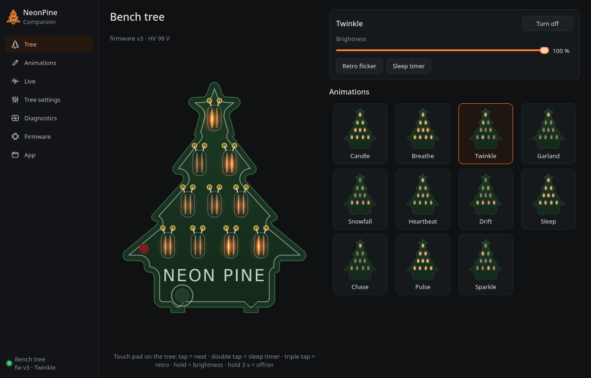
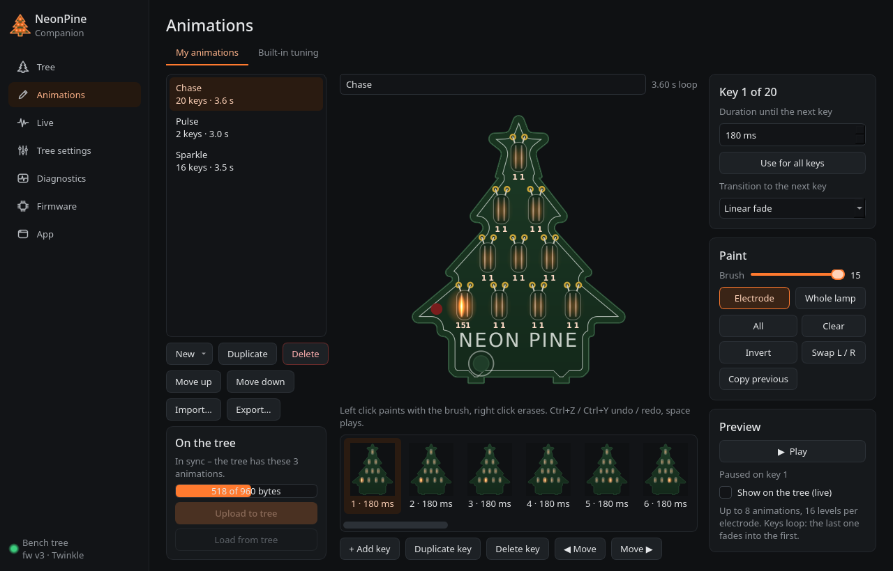

# NeonPine Companion

A desktop app for the NeonPine tree, for Linux and Windows. It lives in the system tray and talks to the tree over USB.
The tree needs no driver on Windows; on Linux it needs a udev rule.





| Page | What it does |
|---|---|
| **Tree** | Shows the tree as it glows right now: the firmware's own animation code runs on the tree's clock. Includes on/off, brightness, retro flicker, the sleep timer, and every animation (built-in and custom) as a live thumbnail. Click the touch pad in the picture to go to the next animation. |
| **Animations › My animations** | Keyframe editor. Paint the 20 electrodes (16 levels each) on the tree picture, arrange keys on a timeline with durations (≤ 16 s) and transitions (hold / linear / smooth), with undo/redo. Play it back in the app or **live on the tree** while you paint. Start from 8 patterns (chase, rise, rain, sweep, ping-pong, pulse, sparkle, star) or sampled from a built-in animation. Import/export JSON. **Upload to tree** stores up to 8 animations (952 bytes) in the tree's flash; they then play without the PC and are reachable by tap. |
| **Animations › Built-in tuning** | Speed (×⅛…×4), brightness and base glow of Candle, Breathe, Twinkle, Garland, Snowfall and Heartbeat, with a live preview. Changes are applied to the tree immediately and saved there. |
| **Live** | Drives the tree from the PC: **music** (what the computer is playing, or a microphone / line in: spectrum, level meter or beat), **CPU load**, or **paint** by hand. The tree returns to its animation 2.5 s after the stream stops. |
| **Tree settings** | Name, what to play after plugging in (last state, or a fixed animation/style/brightness), which animations tap and wave step through, the drift list and its timing, crossfade time, sleep timer length, light sensor, dimming mode. Also backup/restore of settings and animations to a file, and factory settings. |
| **Diagnostics** | HV rail, boost, power budget, touch pad (raw vs. threshold), light sensor, PWM timing, supply, free RAM, faults (with *clear*). Under *Advanced*: HV setpoint, touch threshold, budget limiter, bring-up shows. |
| **Firmware** | Updates the tree with the firmware bundled with the app (or a `.bin` file): it reboots into the USB bootloader, then erases, writes, verifies and starts the image (~10 s). Settings and custom animations survive. *Recovery* catches the bootloader's 5 s window if the tree no longer shows up. |
| **App** | Start with the computer (tray), start hidden, close to tray, notifications, a daily on/off schedule (while the app runs), live frame rate. |

**Tray menu**: on/off, animation, brightness, sleep timer, retro, open, quit. Left-click shows or hides the window.
Starting the app a second time brings up the running instance.

The tree needs **firmware v3** (in `../firmware/neonpine_test/`) for custom animations, tuning, settings and live mode.
With older firmware the app still works as a remote control and can update the firmware.

## Run from source

Python 3.9+ and PySide6.

```sh
# Arch:            sudo pacman -S pyside6
# Debian/Ubuntu:   sudo apt install python3-pyside6.qtwidgets python3-pyside6.qtnetwork python3-pyside6.qtmultimedia
# anything / Windows:  pip install PySide6
python3 neonpine-companion.py          # --tray starts hidden in the tray
```

**Linux, once:** let your user access the tree, and optionally add a menu entry:
```sh
sudo cp ../firmware/tools/99-neonpine.rules /etc/udev/rules.d/ && sudo udevadm control --reload && sudo udevadm trigger
sudo usermod -aG plugdev $USER   # then log out and back in
packaging/install_linux.sh       # menu entry + icon (--udev also installs the rule)
```

## Standalone builds

```sh
pip install PySide6 pyinstaller
python packaging/build.py      # bundles ../firmware/neonpine_test/neonpine_test.bin if it has been built
```
* Windows → `dist/NeonPine Companion.exe` (single file)
* Linux → `dist/NeonPine-Companion/` (folder; `--onefile` for a single file)

PyInstaller doesn't cross-compile: build each OS on that OS. `.github/workflows/companion.yml` does this on GitHub:
it builds the firmware on Ubuntu, then the Windows `.exe` and a Linux tarball with that firmware inside, and attaches them
to the workflow run.

## How it fits together

| File | |
|---|---|
| `hid_backend.py` | HID feature reports with no extra packages: Linux hidraw ioctls, Windows `hid.dll`/`setupapi` via ctypes, otherwise the `hid` module |
| `device.py` | The firmware protocol: status, commands, settings page, store transactions (sequence-numbered, retried), live frames |
| `custom.py` | Custom animations: model, the tree's binary blob, JSON files, pattern generators |
| `builtin.py` | The firmware's animations ported 1:1 (same Q12 integer math and tables), so previews match the tree |
| `mirror.py` | Renders what the tree is showing from its status (crossfades, drift, custom, live, brightness) |
| `flasher.py` | Firmware updates: a Python port of minichlink's b003boot programmer (ch32fun, MIT) |
| `audio_capture.py` | Audio for the music visualizer: PulseAudio/PipeWire through libpulse (lists monitors, which Qt hides) and WASAPI loopback on Windows, both via ctypes; Qt Multimedia otherwise |
| `worker.py` | USB on its own thread: connect/reconnect, polling, jobs, live streaming, flashing |
| `app.py` | Window, tray, single instance, schedule; `pages_*.py` are the pages, `widgets.py` the theme and the tree drawing |

The protocol is documented in `../firmware/README.md` (USB protocol) and at the top of `device.py`.

Untested so far: the Windows HID backend, WASAPI loopback capture and Windows builds (written against the Win32 API, not run yet) and macOS
(it should work through `pip install hidapi`).
