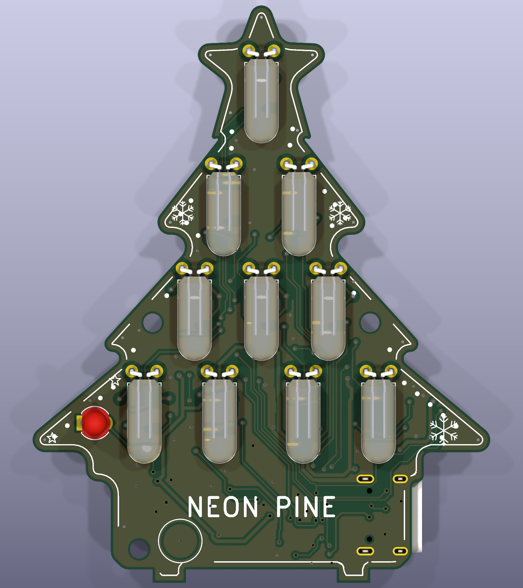
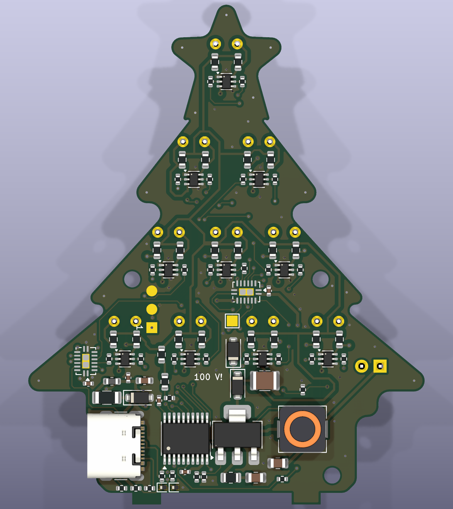
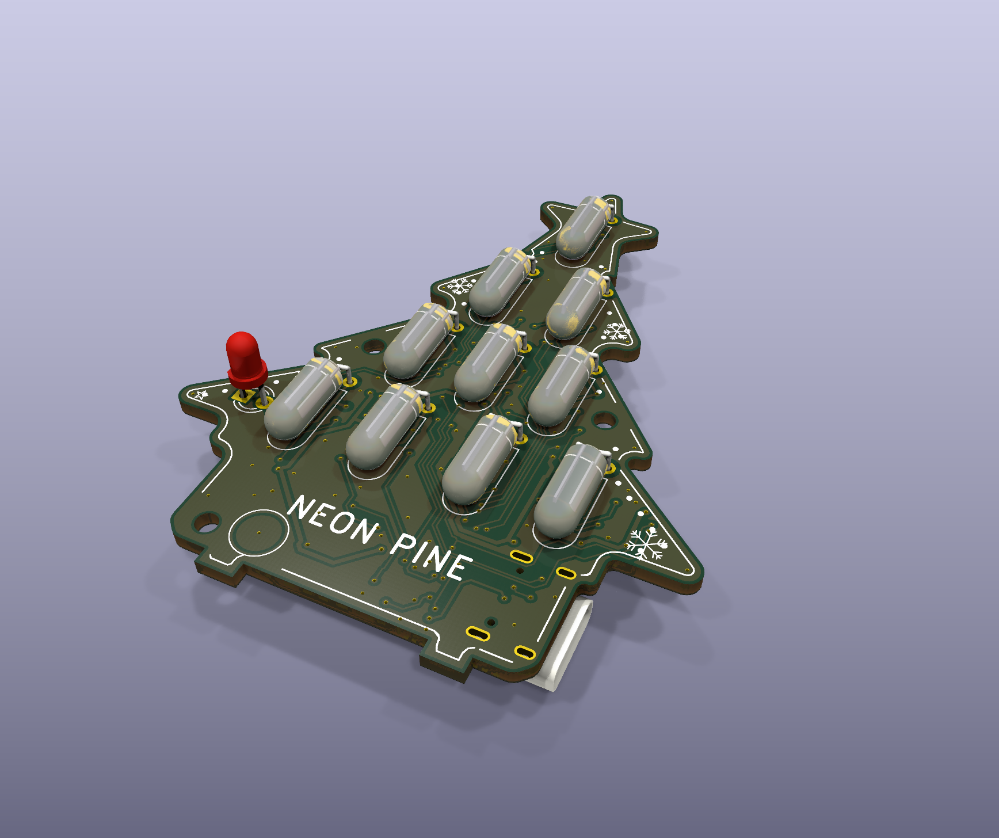
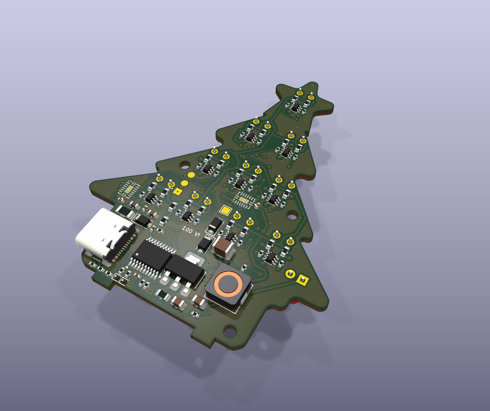
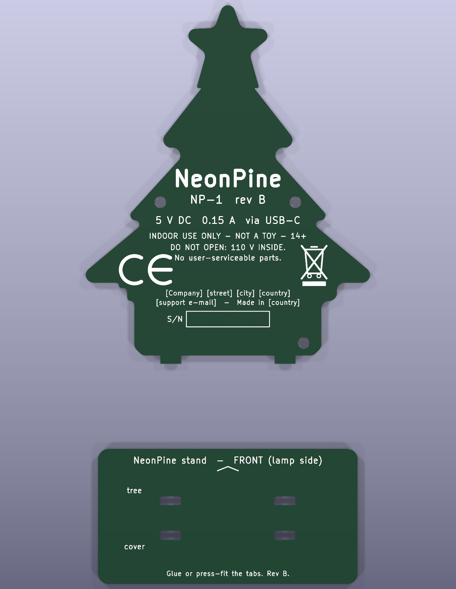
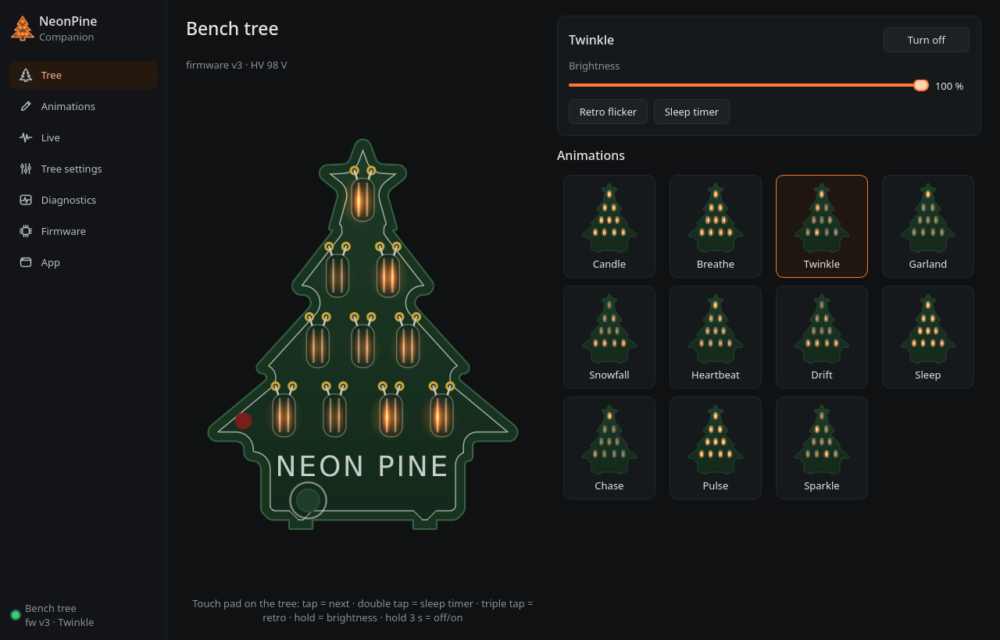

# NeonPine

A 55 × 69 mm tree‑shaped PCB night light with 10 orange NEON‑3 glow lamps, powered from USB‑C 5 V. A CH32V003 runs a
75–105 V boost converter and drives every lamp through its own H‑bridge, so either electrode of a lamp can glow, both, or
neither. A touch pad on the trunk, a light sensor and a USB link to the **NeonPine Companion** desktop app control it.

| Front | Back (cover removed) |
|---|---|
|  |  |
|  |  |

| Rear cover (outer face) and stand base |
|---|
|  |

Renders of the current layout (`kicad-cli pcb render`, regenerated by `python3 tools/docs.py`).

> ⚠ **High voltage.** The back of the board carries up to 105 V DC while the tree runs (HV+, lamp nets, Q1, L11, D1, C4).
> Keep the rear cover on. Don't touch the back while the board is powered. C4 drops below 60 V about 1 s after unplugging.

## Touch controls

The trunk pad is the round pad at the bottom left, below "NEON PINE".

| Action | Result |
|---|---|
| Tap | Next animation (crossfade). Steps through the tap list, by default the eight built‑in animations |
| Double tap | Sleep timer on/off: dims over 20 min, then switches off |
| Triple tap | Style: **normal** (steady) ↔ **retro** (shorter strike pulses that flicker like an old sign, and darker animations where dim lamps switch fully off) |
| Touch and hold (> 0.45 s) | Brightness ramp, alternating direction each hold |
| Hold for 3 s | Off / on. While off, nothing else reacts |
| Wave a hand over the tree | Next animation |
| Room gets dark / bright | On at dusk (< 20 lx), off in daylight (> 100 lx); brightness follows the room |

The light sensor is the small ball in the left branch. Q2 is not fitted on the first board yet, and the thresholds are untested (see
[firmware/README.md](../firmware/README.md#light-sensor-q2-tept4400--not-fitted-on-board-1-yet-untested)).

**Animations:** Candle · Breathe · Twinkle · Garland · Snowfall · Heartbeat · Drift (cycles through the others, 3 min each) ·
Sleep (candle + sleep timer). Up to 8 custom keyframe animations made in the companion app are stored in the tree and can be
added to the tap list.

The tree remembers the last animation, style and brightness across power cycles (configurable in the companion app).

## Firmware

[`firmware/`](../firmware/) holds everything that runs on the CH32V003:

| Dir | What |
|---|---|
| [`firmware/neonpine/`](../firmware/neonpine/) | The firmware (USB 1209:D003 "NeonPine tree"): HV boost regulation, the animations (`anim.c`, Q12 fixed point), touch UI, light sensor, sleep timer, power budget, settings and custom animation store in flash, USB HID status / commands / live frames |
| [`firmware/bootloader/`](../firmware/bootloader/) | [rv003usb](https://github.com/cnlohr/rv003usb) USB HID bootloader (1209:B003) in the 1920‑byte boot area. It waits ≈ 5 s after power‑up, then starts the firmware |
| [`firmware/installer/`](../firmware/installer/) | Writes the bootloader + option bytes from the chip itself, for programmers that only write main flash (PicoRVD) |
| [`firmware/tools/npctl.py`](../firmware/tools/npctl.py) | Command‑line control over USB (Linux hidraw, no pip packages): status, shows, style, brightness, HV, PWM, diagnostics |

Settings and custom animations live in the last 1 kB of flash, so firmware updates keep them.
The full description (lamp drive, PWM timing, power budget, light sensor, USB protocol) is in
[firmware/README.md](../firmware/README.md).

## Installation

### The tree
1. Push the two tabs at the bottom of the tree and of its rear cover into the four slots of the stand base (the side marked
   FRONT faces the lamps).
2. Connect a USB‑C cable to the socket on the right side of the "pot", and the other end to a certified 5 V USB adapter or a
   computer.
3. The tree lights up after the ≈ 5 s bootloader wait. In a completely dark room, neon lamps can take a few seconds to strike
   the first time.

### Companion app
Standalone builds (Windows `.exe`, Linux tarball, both with the current firmware inside) come from the
[`companion.yml`](../.github/workflows/companion.yml) workflow run on GitHub. To run it from source (Python 3.9+, PySide6):

```sh
# Arch:            sudo pacman -S pyside6
# Debian/Ubuntu:   sudo apt install python3-pyside6.qtwidgets python3-pyside6.qtnetwork python3-pyside6.qtmultimedia
# anything / Windows:  pip install PySide6
python3 companion/neonpine-companion.py          # --tray starts hidden in the tray
```

Windows needs no driver. **On Linux, once:** give your user access to the tree, and optionally add a menu entry:
```sh
sudo cp firmware/tools/99-neonpine.rules /etc/udev/rules.d/ && sudo udevadm control --reload && sudo udevadm trigger
sudo usermod -aG plugdev $USER                   # then log out and back in
companion/packaging/install_linux.sh             # menu entry + icon (--udev also installs the rule)
```

### Building and flashing the firmware
Setup, once per PC (Arch; the udev rule is the one above):
```sh
sudo pacman -S --needed riscv64-elf-gcc riscv64-elf-newlib
cd firmware && make      # clones rv003usb + ch32fun (pinned) into deps/, builds minichlink, bootloader and firmware
```

**First flash, once per board:** connect a WCH‑LinkE to the J2 pogo pads `5V – SWIO – GND` (pin 1 = square = 5V), with the
rear cover off. Then run this:
```sh
make first-flash         # option bytes (boot from bootloader, NRST off), USB bootloader, firmware
```
No WCH‑LinkE? A Raspberry Pi Pico running PicoRVD works through `firmware/installer/` (`make pico`). Its wiring
and caveats are in [firmware/README.md](../firmware/README.md#with-a-raspberry-pi-pico-picorvd-instead).

**Updates over USB**, no programmer needed. Use the companion app's *Firmware* page, or run this:
```sh
make flash               # reboots the running firmware into the bootloader, writes and starts the new image
```
If the firmware no longer enumerates, catch the bootloader's 5 s window instead. Start this, then plug the tree in:
`until make -C neonpine flash; do sleep 0.3; done`. The companion app's *Recovery* button does the same.

## Companion app

[`companion/`](../companion/) is a desktop app for Linux and Windows. It sits in the system tray and talks to the tree over
USB. The tree needs firmware v3 for everything below. With older firmware the app works as a remote control and updater.



| Page | What it does |
|---|---|
| **Tree** | Live mirror of the tree (the firmware's animation code on the tree's clock), on/off, brightness, retro, sleep timer, every animation as a live thumbnail |
| **Animations** | Keyframe editor for custom animations (20 electrodes × 16 levels, timeline, transitions, live preview on the tree, upload up to 8 to the tree), and tuning of the built‑in ones (speed, brightness, base glow) |
| **Live** | Drives the tree from the PC: music (playback or microphone: spectrum, level meter, beat), CPU load, or painting by hand |
| **Tree settings** | Name, power‑up behaviour, tap list, drift list and timing, crossfade, sleep timer length, light sensor, dimming mode, backup / restore |
| **Diagnostics** | HV rail, boost, power budget, touch, light sensor, PWM timing, supply, free RAM, faults |
| **Firmware** | Updates the tree with the bundled image or a `.bin` file (≈ 10 s; settings and animations are kept), and recovery |

The tray menu has on/off, animation, brightness, sleep timer and retro. More in [companion/README.md](../companion/README.md).

## Repository layout

| Path | |
|---|---|
| `NeonPine.kicad_*` | Tree PCB (KiCad): schematic and layout |
| `NeonPine-cover.kicad_pcb` | Rear cover and stand base |
| `firmware/` | Firmware, bootloader, installer, tools ([above](#firmware)) |
| `companion/` | Companion desktop app ([above](#companion-app)) |
| `tools/` | Board generation, routing, docs and netlist scripts |
| `fab/`, `production/` | Fabrication outputs |
| `bom/` | Bill of materials |
| `docs/` | This README, manuals, generated renders and PDFs, compliance |

## Design, manufacturing and compliance documents

| Document | Purpose |
|---|---|
| [../DESIGN.md](../DESIGN.md) | Design description, schematic notes, layout, BOM, **open items before market** |
| [NeonPine-schematic.pdf](NeonPine-schematic.pdf) | Schematic |
| [user-manual.md](user-manual.md) | User manual + safety information (EN draft) |
| [manufacturing.md](manufacturing.md) | PCB spec, assembly, programming, end‑of‑line test, traceability |
| [mcu-netlist.md](mcu-netlist.md) | Reduced netlist for firmware: U1 pin map, 74HC595 bit order, lamp drivers, peripheral / option-byte setup (generated by `tools/mcu_netlist.py`) |
| [compliance/00-regulatory-roadmap.md](compliance/00-regulatory-roadmap.md) | What applies (CE / UKCA / FCC / ICES), what doesn't, status tracker |
| [compliance/01-risk-assessment.md](compliance/01-risk-assessment.md) | GPSR risk assessment, hazard register, verification record |
| [compliance/02-emc-test-plan.md](compliance/02-emc-test-plan.md) | EMC design review, rev B measures, pre‑compliance & lab test plan |
| [compliance/03-materials-compliance.md](compliance/03-materials-compliance.md) | RoHS / REACH evidence per BOM line |
| [compliance/04-eu-declaration-of-conformity.md](compliance/04-eu-declaration-of-conformity.md) | EU DoC template |
| [compliance/05-fcc-sdoc.md](compliance/05-fcc-sdoc.md) | FCC SDoC + mandatory user statements |
| [compliance/06-labelling-and-packaging.md](compliance/06-labelling-and-packaging.md) | Product / packaging markings |
| [compliance/07-technical-file-index.md](compliance/07-technical-file-index.md) | Technical file contents and status |

`python3 tools/docs.py` regenerates the schematic PDF, the renders in `img/` (`kicad-cli pcb render`), `mcu-netlist.md`, the `fab/`
outputs and all PDFs except the compliance documents; run it after every schematic or layout change.
